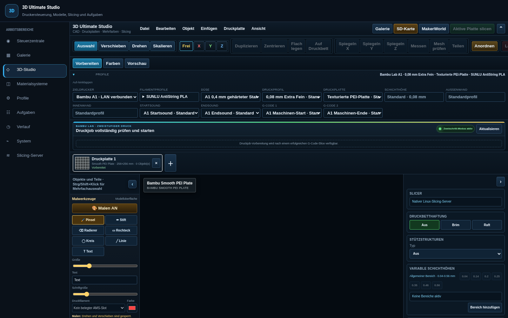
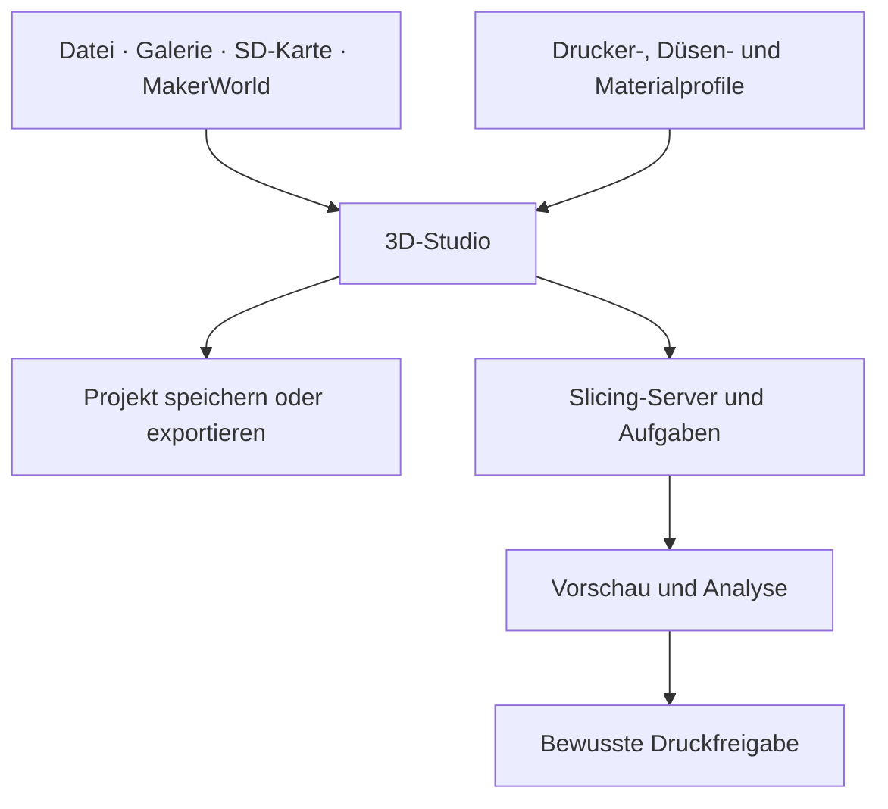

# Ultimate 3D Studio

**Modelle vorbereiten, Materialien zuordnen und Druckabläufe überblicken – direkt in Home Assistant.**

[](https://github.com/Taracraft/3D-Ultimate-Center/actions/workflows/studio-source-contract.yml)

[**Zum Studio-Handbuch**](studio/README.md) · [Erste Schritte](studio/README.md#schnellstart) · [Alle Funktionen](studio/README.md#funktionen) · [Slicer-Installation](studio/Slicer-Server/INSTALLATION.md)



*Echte Puppet-Aufnahme einer bestehenden Home-Assistant-Installation, 15. Oktober 2026. Installierte Ansichten können vom aktuellen Quellstand abweichen.*

## Was du mit dem Studio machen kannst

| Dein Vorhaben | Werkzeuge im Studio |
| --- | --- |
| Ein Modell vorbereiten | STL/3MF öffnen, verschieben, drehen, skalieren, spiegeln und auf dem Druckbett ausrichten |
| Eigene Formen aufbauen | Würfel, Zylinder, Kugel, Kegel, Ring und Platte einfügen; messen, teilen und Mesh prüfen |
| Mehrere Druckplatten planen | Objekte auf Platten organisieren und die aktive Platte gezielt vorbereiten |
| Mehrfarbig arbeiten | Pinsel, Stift, Radierer, Rechteck, Kreis, Linie und Text mit zugeordneten Materialkanälen |
| Druckparameter abstimmen | Drucker, Düse, Filament, Druckprofil und Druckplatte getrennt auswählen |
| Eine Bibliothek pflegen | Galerie, Ordner, Suche, Upload, ZIP-Import und Duplikatprüfung |
| Modelle finden | MakerWorld-Modelle und Druckprofile ansehen und gezielt ins Studio übernehmen |
| Ergebnisse prüfen | Schichtvorschau mit auftragsgebundenen Filamentfarben, Analyse und Diagnoseansichten |
| Den Betrieb überblicken | Steuerzentrale, Kamera, Materialsysteme, Aufgaben, Verlauf und Systemdiagnose |

Die Verfügbarkeit einzelner Abläufe hängt von Drucker, Profilen, Berechtigungen und dem verbundenen Slicer ab. Eine Anzeige in der Oberfläche ist kein Nachweis für jede Hardwarekombination.

## Ein Arbeitsbereich für den ganzen Ablauf



Das [Handbuch](studio/README.md) führt durch die einzelnen Schritte und erklärt, welche Aktionen nur ein Modell bearbeiten, einen Slice erzeugen oder tatsächlich den Drucker ansprechen.

## Schnell zurechtfinden

| Du suchst … | Hier geht es weiter |
| --- | --- |
| Einen Einstieg ohne Druckstart | [Erste Schritte im Studio](studio/README.md#schnellstart) |
| Import, CAD, Platten und Projektverwaltung | [Modelle und Druckplatten](studio/README.md#modelle) |
| AMS, externe Spule und Druckprofile | [Material und Profile](studio/README.md#material) |
| Bemalung und Mehrfarben | [Malen mit Materialkanälen](studio/README.md#malen) |
| Schichten, Farben und Analyse | [Vorschau verstehen](studio/README.md#vorschau) |
| Tastenkürzel und typische Probleme | [Bedienung](studio/README.md#tasten) · [Fehlerhilfe](studio/README.md#hilfe) |
| Einen neuen separaten Linux-Testserver | [Manueller Testserver-Ablauf](studio/Slicer-Server/LINUX_TEST_SERVER_RUNBOOK.md) |
| Technische Zusammenhänge | [Architektur](studio/ARCHITECTURE.md) · [Slicer-Server](studio/Slicer-Server/README.md) |

## Installation und aktueller Stand

**Die vollständige Quelllieferung und ihre automatisierten Prüfungen sind vorhanden.** Die neue Compose-Installation benötigt weiterhin ihre echte Linux-, Engine-, TLS-, Neustart-, Upgrade- und Restore-Abnahme. Eine grüne Quellprüfung ist keine Betriebsfreigabe.

Das Studio läuft als Home-Assistant-Integration mit Frontend. Der Slicer ist ein eigener Dienst; Docker Compose ist der vorgesehene Weg für die neue saubere Installation. Bestehende native Installationen benötigen eine gesondert geprüfte Migration. Das [Handbuch](studio/README.md#einrichtung) verlinkt die passenden Einstiegspunkte.

Nach dem Klonen liegt die Studio-Quellwurzel unter `studio/`:

```bash
git clone https://github.com/Taracraft/3D-Ultimate-Center.git
cd 3D-Ultimate-Center/studio
```

Relative Befehle der Komponenten-Dokumentation gelten ab dort. Generierte Kontexte und Testpakete immer in ein **neues absolutes Verzeichnis außerhalb des gesamten Klons** schreiben.

## Lizenz und Herkunft

Der bestehende [MIT-Hinweis](LICENSE) bleibt erhalten. Für neues eigenes Material im Slicer-Server-Bereich gelten dessen [gesonderte Privatnutzungsbedingungen](studio/Slicer-Server/LICENSE). Früher lizenzierte und fremde Bestandteile behalten ihre jeweiligen Rechte; ausgewählte Upstream-Profildaten stehen unter den mitgelieferten AGPL-Bedingungen.

Die konkreten Grenzen findest du in [SOURCE_NOTICES.md](SOURCE_NOTICES.md) und der [Dateizuordnung](source-license-map.json).
