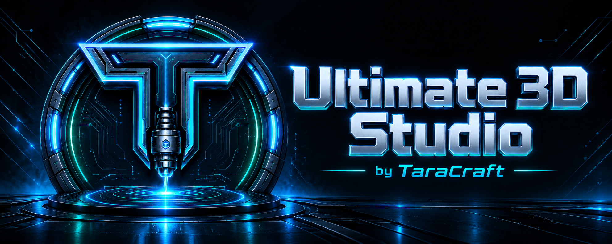
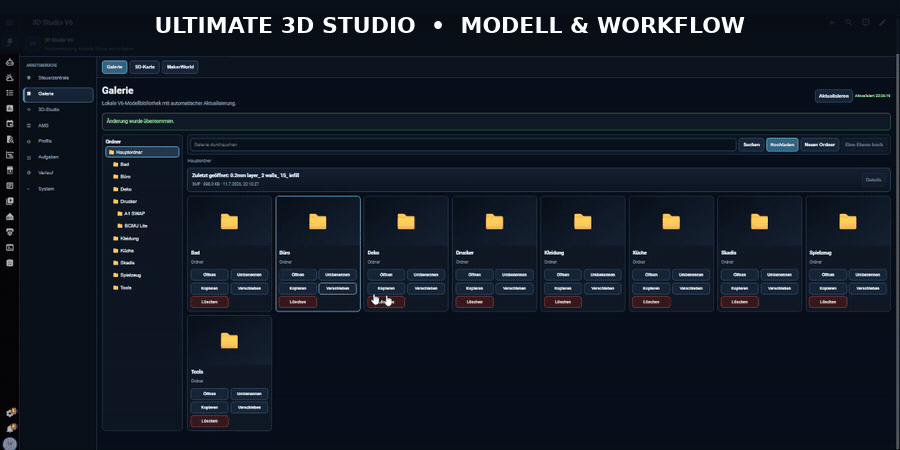

# Ultimate 3D Studio





Die Animation nutzt tatsächlich aufgenommene, zugeschnittene Studio-Frames; Browserleiste, Adressfeld und Taskleiste sind nicht enthalten. Sie zeigt einen kurzen Modell-/Arbeitsablauf und ist kein Nachweis einer vollständigen Funktions- oder Systemabnahme.

**Dein Modell. Deine Materialien. Deine Druckplatte. Direkt in Home Assistant.**

Modelle sammeln, Geometrie bearbeiten, Flächen bemalen und Druckvorhaben nachvollziehbar vorbereiten: Ultimate 3D Studio verbindet die Browseroberfläche mit einer Home-Assistant-Integration und dem eigenständigen [Ultimate Slicer Server](https://github.com/Taracraft/3D-Ultimate-Slicer-Server).

[](https://github.com/Taracraft/3D-Ultimate-Center/actions/workflows/studio-source-contract.yml)

[PDF-Handbuch](studio/handbook/Ultimate_3D_Studio_Handbuch.pdf) · [Handbuch](studio/README.md) · [Funktionen](studio/handbook/FEATURES.md) · [CAD-Beispiele](studio/handbook/CAD_EXAMPLES.md) · [Wiki](https://github.com/Taracraft/3D-Ultimate-Center/wiki) · [Slicer-Server](https://github.com/Taracraft/3D-Ultimate-Slicer-Server)


**Entwicklungsstand:** 77 katalogisierte Funktionen und 41 Zusatzanforderungen. Viele vollständige Funktionsabnahmen sind offen. Quellen, Tests und Dokumentation sind veröffentlicht; daraus folgt kein vollständiger Produktrelease. Die konkrete Auslieferung beschreibt [RELEASE_STATUS.md](studio/Slicer-Server/RELEASE_STATUS.md).

## Ein Arbeitsplatz für deinen Modellaufbau

| Dein Vorhaben | Das Studio bietet |
| --- | --- |
| Ein Modell vorbereiten | STL/3MF öffnen, Grundkörper erzeugen, verschieben, drehen, skalieren und auf der Platte ausrichten |
| Eine Szene aufbauen | Mehrere Druckplatten, Objektlisten, Mehrfachauswahl, Duplizieren und gespeicherte Projekte |
| Material bewusst zuordnen | Getrennte Auswahl von Drucker, Düse, Filament, Druckprofil und Oberfläche; AMS und externe Spule unterscheiden |
| Flächen gestalten | Pinsel, Stift, Radierer, Kreis, Rechteck, Linie und Text mit materialgebundenen Malbereichen |
| Ein Ergebnis beurteilen | Vorbereitungs-, Farb- und Schichtansicht, Toolpaths und Diagnosefilter für vorhandene Ergebnisse |
| Den Bestand überblicken | Galerie mit Ordnern, Suche und ZIP-Verwaltung, MakerWorld-Zugang, Aufgaben, Verlauf und Kamera |

Die [Funktionsübersicht](studio/handbook/FEATURES.md) nennt Umfang und Grenzen. Angezeigte Hardware- oder Engineauswahl ersetzt keine Abnahme der konkreten Kombination.

## Womit möchtest du beginnen?

- **Zum ersten Mal hier:** Folge dem [ersten Projekt](studio/README.md#erstes-projekt). Ein Würfel genügt, um Bearbeitung und Speichern kennenzulernen.
- **Modelle organisieren:** Öffne [Galerie und Druckerspeicher](studio/README.md#galerie) oder den [MakerWorld-Ablauf](studio/README.md#makerworld).
- **Farben und Materialien:** Lies [Bemalung](studio/README.md#bemalung), [Materialkanäle](studio/README.md#material) und [Profile](studio/README.md#profile) zusammen.
- **Eine Installation einrichten:** Beginne mit [Integration, HACS und Slicer-Verbindung](studio/README.md#einrichtung) und dem [Slicer-Schnellstart](studio/Slicer-Server/DOCKER_QUICKSTART.md).
- **Ein Problem eingrenzen:** Die [Fehlerhilfe](studio/README.md#fehlersuche) führt von der Beobachtung zum nächsten prüfbaren Schritt.

## Installation mit dem TaraCraft-Assistenten

**Home Assistant Container hat keinen Supervisor und keinen Menüpunkt Apps.**
Der Slicer läuft als eigener Docker-Compose-Dienst. Für diesen Weg muss keine
Supervisor-App installiert und kein App-Repository unter System gesucht werden.

Wenn dir die aktuelle einzelne Datei `TaraCraft-Install.sh` bereitgestellt wurde,
kopiere sie auf den Linux/amd64-Server und starte sie dort im Terminal:

```sh
sudo bash TaraCraft-Install.sh
```

Mit `bash TaraCraft-Install.sh --demo` lässt sich die Oberfläche vorher ansehen;
`bash TaraCraft-Install.sh --self-test` führt isolierte Prüfungen aus. Der Assistent
zeigt den aktuellen Schritt oben und das echte, scrollbar bleibende Shell-Protokoll
darunter. Bei einer vorhandenen zugehörigen Sitzung **Fortsetzen** wählen.

Die [ausführliche Anleitung für Container, HACS, MQTT, Slicer und Dashboard](studio/Slicer-Server/INSTALLATION.md)
beschreibt die geführte Einrichtung, persönliche GitHub-Geräteanmeldung,
automatische Repository-Übernahme und das vollständige Zurücksetzen. Die
Automatisierungen gelten für den aktuellen separat bereitgestellten Assistenten
mit seinen gebundenen Setup-Ergänzungen. Sie sind keine Behauptung, dass der
unveränderte HACS-Tag 6.0.5 diese neuen Formulare bereits enthält.

Für eine Installation ohne diesen Assistenten bleibt der unten verlinkte normale
HACS-/Docker-Weg gültig. Anmeldedaten, Docker-Host und Netzverbindungen werden immer
für die eigene Umgebung eingerichtet.

## Quellen und Entwicklung

| Pfad | Inhalt |
| --- | --- |
| `custom_components/ultimate_3d_studio/` | Root-Integrationsprojektion für HACS einschließlich Frontend-Assets |
| `homeassistant/custom_components/ultimate_3d_studio/` | Erhaltene Kompatibilitätsprojektion |
| `studio/frontend/` | Browseroberfläche |
| `studio/api/` und `studio/core/` | Anwendungslogik |
| `studio/Slicer-Server/` | Slicer-, Container- und Betriebsquellen |
| `studio/handbook/` | Funktionskatalog, Beispiele und Originalbilder |

Für Entwicklungsbefehle ist nach dem Klonen `studio/` das Arbeitsverzeichnis. [Architektur](studio/ARCHITECTURE.md), [Entwicklung](studio/handbook/wiki/Entwicklung.md) und [Änderungen](studio/CHANGELOG-DE.md) bieten den technischen Einstieg.

Es gelten die [Lizenz](LICENSE), die [bereichsspezifischen Hinweise](SOURCE_NOTICES.md) und die [Dateizuordnung](source-license-map.json). Slicer- und Drittanbietermaterial besitzen teilweise eigene Bedingungen. Herkunft und Grenzen der Originalaufnahmen sind ebenfalls in den Lizenzhinweisen dokumentiert.
