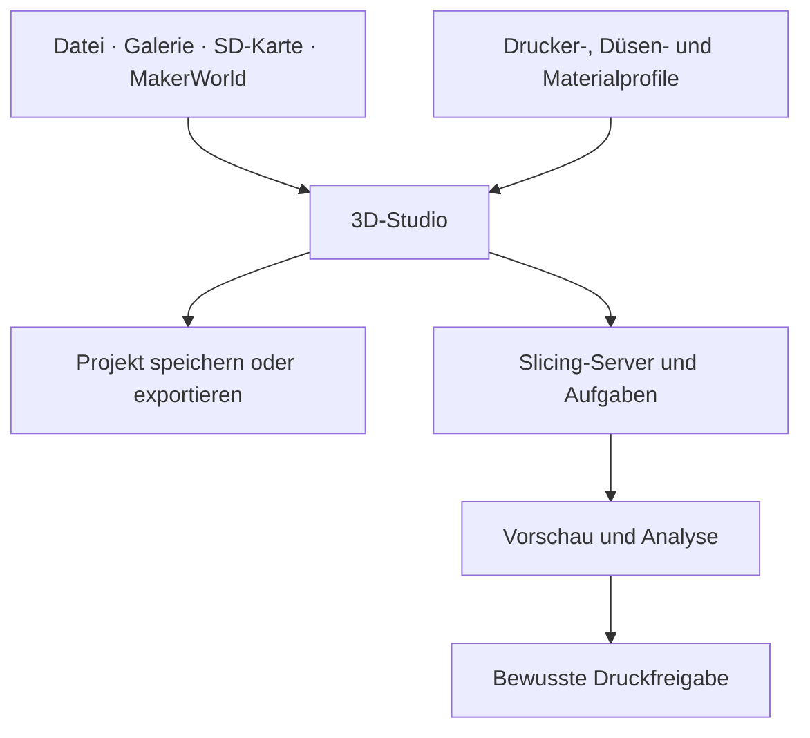

# Ultimate 3D Studio

**Modelle vorbereiten, Materialien zuordnen und Druckabläufe überblicken – direkt in Home Assistant.**

[](https://github.com/Taracraft/3D-Ultimate-Center/actions/workflows/studio-source-contract.yml)

[**Zum Studio-Handbuch**](studio/README.md) · [Erste Schritte](studio/README.md#schnellstart) · [Detaillierter Funktionskatalog](studio/handbook/FEATURES.md) · [CAD-Beispiele](studio/handbook/CAD_EXAMPLES.md) · [Slicer-Installation](studio/Slicer-Server/INSTALLATION.md)


*Echte CAD-Aufnahme aus dem vorhandenen Puppet-Add-on, 15. Oktober 2026. Vier im Studio erzeugte Beispielkörper, keine KI-erfundene Oberfläche. Installierter Build und aktueller Quellstand können abweichen. [Ganze Oberfläche, Beispielaufbau und Bildherkunft](studio/handbook/CAD_EXAMPLES.md).*

## Was du mit dem Studio machen kannst

| Arbeitsbereich | Was du konkret machen kannst | Was du dabei kontrollierst |
| --- | --- | --- |
| **Import und Projekte** | STL/3MF lokal öffnen; Modelle aus Galerie, SD-Karte oder MakerWorld übernehmen; weitere Objekte importieren; Modelle exportieren; Projekte auf HA speichern und wieder öffnen | Geometrie, Materialdaten und gespeicherter Arbeitsstand sind nicht automatisch fertiger G-Code |
| **Auswahl und Bearbeitung** | Einzel-/Mehrfachauswahl, Duplizieren, Kopieren, Ausschneiden, Einfügen, Löschen, Rückgängig und Wiederholen | Modelle und Malbereiche sind getrennte Ebenen |
| **CAD-Transformation** | Verschieben, Drehen, Skalieren; freie oder X/Y/Z-begrenzte Bearbeitung; Spiegeln an allen drei Achsen | Abmessungen, Orientierung und Bettgrenzen |
| **Ausrichtung** | Zentrieren, auf Druckbett setzen, flach legen und mehrere Objekte automatisch anordnen | Auflage, Abstände und mögliche Kollisionen |
| **Geometriewerkzeuge** | Messen, Mesh prüfen/reparieren und ein ausgewähltes Modell geometrisch teilen | Ergebnis prüfen; keine pauschale Reparaturgarantie |
| **Eigene Formen** | Würfel, Zylinder, Kugel, Kegel, Ring und Platte direkt erzeugen; düsenabhängige First-Layer-Testgeometrie vorbereiten | Geometrieerzeugung startet keinen Kalibrierdruck |
| **Druckplatten** | Mehrere Platten anlegen, zwischen ihnen wechseln, Objekte getrennt organisieren und bewusst die aktive Platte bearbeiten | Objektliste, Einstellungen, Vorschau und Slice sind plattenbezogen |
| **Drucker- und Prozessprofile** | Drucker, Düse, Filament, Druckprofil und Plattenoberfläche getrennt auswählen; lokale und übernommene Cloud-Profile unterscheiden | Unterstützte Kombination und echte Hardwaregrenzen |
| **Prozessoptionen** | Betthaftung, Stützen, Schichthöhe, variable Höhenbereiche und angebotene Prozessüberschreibungen einstellen | Explizite Werte gegenüber Profilstandard |
| **G-Code und Sounds** | Start-/Endsound sowie Maschinen-Start-/Endbausteine separat verwalten | Ausführungsrelevante Werte bewusst prüfen |
| **Materialsysteme** | AMS-/Systemkonfiguration, erkannte Hardware, belegte Fächer und externe Spule auseinanderhalten | Keine erfundenen Slot-/RFID-/Farbwerte bei fehlender Telemetrie |
| **Bemalung** | Pinsel, Stift, Radierer, Rechteck, Kreis, Linie und Text auf Modellflächen anwenden; Malbereiche separat verwalten | Farbe folgt einem tatsächlich zugeordneten Materialkanal |
| **Vorschau und Analyse** | Vorbereiten, Farben und echte Schicht-/Toolpath-Vorschau unterscheiden; Schichten und Diagnosefilter prüfen | Auftragsgebundene Filamentfarben statt späterer AMS-Werte |
| **Bibliothek und MakerWorld** | Galerie mit Ordnern, Suche, Upload, ZIP-Import und Duplikatprüfung; externe Modelle und Druckprofile gezielt übernehmen | Berechtigung, Importprüfung und private Inhalte |
| **Aufgaben und Verlauf** | Warteschlange, Jobzustände, vergangene Aufträge und Ergebnisse nachvollziehen | Slice, Druckvorbereitung und Druckstart sind getrennte Schritte |
| **Steuerzentrale und System** | Druckerzustand, Fortschritt, Störungen, Kamera, Verbindungen und getrennten Slicer überblicken | Tatsächliche Erreichbarkeit statt bloßer Anzeige einer Schaltfläche |

Der [ausführliche Funktionskatalog](studio/handbook/FEATURES.md) geht jede Funktion einzeln mit Nutzen, Bediengrenze und Quell-Einstiegspunkt durch. Das [Handbuch](studio/README.md) ergänzt Schrittfolgen, Tastenkürzel und Fehlerhilfe.

Die Verfügbarkeit einzelner Abläufe hängt von Drucker, Profilen, Berechtigungen und dem verbundenen Slicer ab. Eine Anzeige in der Oberfläche ist kein Nachweis für jede Hardwarekombination.

## So sieht der echte Arbeitsbereich aus

[](studio/handbook/CAD_EXAMPLES.md)

Für die Originalaufnahmen wurden nur vier synthetische Grundkörper angelegt und angeordnet. Kein privates Modell, kein gespeicherter Auftrag und kein Druckstart. [Beispiel selbst nachbauen](studio/handbook/CAD_EXAMPLES.md).

## Zwei Repositories, klare Aufgaben

| Repository | Inhalt |
| --- | --- |
| [3D-Ultimate-Center](https://github.com/Taracraft/3D-Ultimate-Center) | Studio-Gesamtprodukt, Home-Assistant-Integration, Frontend und gesamter geprüfter Quellstand |
| [3D-Ultimate-Slicer-Server](https://github.com/Taracraft/3D-Ultimate-Slicer-Server) | Separates privates Slicer-Repo mit vollständiger geprüfter Komponentenprojektion, Paketbau, Worker/API, Docker, Tests und Wiki-Dateien |

Das Slicer-Repo enthält keine privaten Modelle, Aufträge, Laufdaten oder Zugangsdaten. Die rund 10,45 GB einer bestehenden Installation sind überwiegend Betriebsdaten, nicht fehlender Quellcode. [Bestandsaufteilung und Engine-Grenzen](studio/Slicer-Server/LIVE_ENGINE_INVENTORY.md).

[Docker vom vollständigen Klon aus bauen](studio/Slicer-Server/DOCKER_QUICKSTART.md) · [Slicer-Quellumfang prüfen](studio/Slicer-Server/REPOSITORY_CONTENTS.md) · [Versioniertes Slicer-Wiki](studio/Slicer-Server/wiki/Home.md)

## Ein Arbeitsbereich für den ganzen Ablauf



Das [Handbuch](studio/README.md) führt durch die einzelnen Schritte und erklärt, welche Aktionen nur ein Modell bearbeiten, einen Slice erzeugen oder tatsächlich den Drucker ansprechen.

## Schnell zurechtfinden

| Du suchst … | Hier geht es weiter |
| --- | --- |
| Einen Einstieg ohne Druckstart | [Erste Schritte im Studio](studio/README.md#schnellstart) |
| Import, CAD, Platten und Projektverwaltung | [Modelle und Druckplatten](studio/README.md#modelle) |
| AMS, externe Spule und Druckprofile | [Material und Profile](studio/README.md#material) |
| Bemalung und Mehrfarben | [Malen mit Materialkanälen](studio/README.md#malen) |
| Schichten, Farben und Analyse | [Vorschau verstehen](studio/README.md#vorschau) |
| Tastenkürzel und typische Probleme | [Bedienung](studio/README.md#tasten) · [Fehlerhilfe](studio/README.md#hilfe) |
| Einen neuen separaten Linux-Testserver | [Manueller Testserver-Ablauf](studio/Slicer-Server/LINUX_TEST_SERVER_RUNBOOK.md) |
| Technische Zusammenhänge | [Architektur](studio/ARCHITECTURE.md) · [Slicer-Server](studio/Slicer-Server/README.md) |

## Installation und aktueller Stand

**Die vollständige Quelllieferung und ihre automatisierten Prüfungen sind vorhanden.** Die neue Compose-Installation benötigt weiterhin ihre echte Linux-, Engine-, TLS-, Neustart-, Upgrade- und Restore-Abnahme. Eine grüne Quellprüfung ist keine Betriebsfreigabe.

Das Studio läuft als Home-Assistant-Integration mit Frontend. Der Slicer ist ein eigener Dienst; Docker Compose ist der vorgesehene Weg für die neue saubere Installation. Bestehende native Installationen benötigen eine gesondert geprüfte Migration. Das [Handbuch](studio/README.md#einrichtung) verlinkt die passenden Einstiegspunkte.

Nach dem Klonen liegt die Studio-Quellwurzel unter `studio/`:

```bash
git clone https://github.com/Taracraft/3D-Ultimate-Center.git
cd 3D-Ultimate-Center/studio
```

Relative Befehle der Komponenten-Dokumentation gelten ab dort. Generierte Kontexte und Testpakete immer in ein **neues absolutes Verzeichnis außerhalb des gesamten Klons** schreiben.

## Lizenz und Herkunft

Der bestehende [MIT-Hinweis](LICENSE) bleibt erhalten. Für neues eigenes Material im Slicer-Server-Bereich gelten dessen [gesonderte Privatnutzungsbedingungen](studio/Slicer-Server/LICENSE). Früher lizenzierte und fremde Bestandteile behalten ihre jeweiligen Rechte; ausgewählte Upstream-Profildaten stehen unter den mitgelieferten AGPL-Bedingungen.

Die konkreten Grenzen findest du in [SOURCE_NOTICES.md](SOURCE_NOTICES.md) und der [Dateizuordnung](source-license-map.json).
