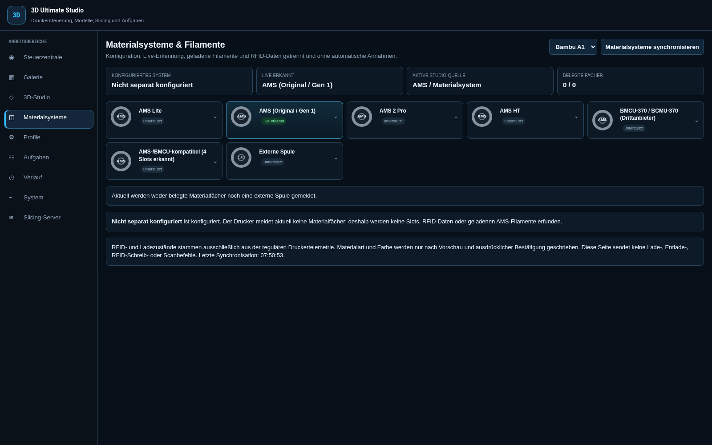
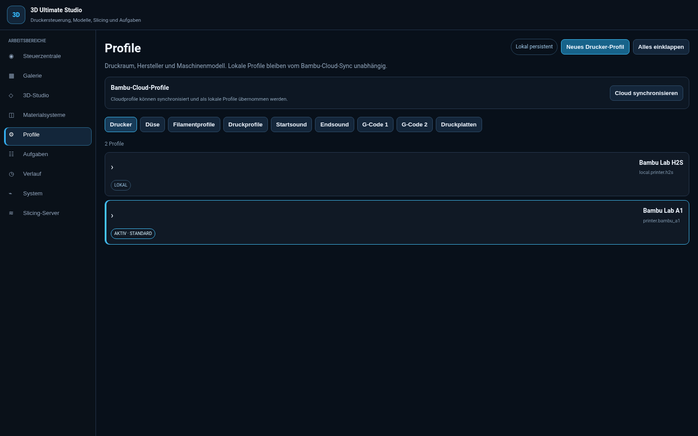

# Ultimate 3D Studio – das Handbuch

**Vom ersten Modell zur vorbereiteten Druckplatte: Import, CAD, Materialien, Bemalung, Vorschau und Auftragsübersicht in Home Assistant.**

[Zur Repo-Startseite](../README.md) · [Detaillierter Funktionskatalog](handbook/FEATURES.md) · [CAD-Beispiele](handbook/CAD_EXAMPLES.md) · [Architektur](ARCHITECTURE.md) · [Slicer-Server](Slicer-Server/README.md)


*Die Bilder sind echte Puppet-Aufnahmen einer bestehenden Home-Assistant-Installation vom 15. Oktober 2026. Sie zeigen die Oberfläche und vorhandene Installationswerte. Der hier beschriebene Funktionsumfang bezieht sich auf die aktuellen Quellen; ein installierter Build kann davon abweichen. Die gezeigte Beispielplatte enthält vier im Studio erzeugte Grundkörper. Die Bilder sind kein Slice- oder Drucknachweis. [Ganze CAD-Oberfläche und Bildherkunft](handbook/CAD_EXAMPLES.md).*

## Inhalt

- [Was das Studio kann](#funktionen)
- [Einrichtung und Voraussetzungen](#einrichtung)
- [Schnellstart ohne Druckstart](#schnellstart)
- [Modelle, Werkzeuge und Druckplatten](#modelle)
- [Materialsysteme und Profile](#material)
- [Bemalung und Mehrfarben](#malen)
- [Vorschau und Analyse](#vorschau)
- [Galerie, SD-Karte und MakerWorld](#quellen)
- [Aufgaben, Verlauf und Druckerübersicht](#aufgaben)
- [Tastenkürzel](#tasten)
- [Typische Fragen und Fehlerhilfe](#hilfe)
- [Quellstand, Betriebsabnahme und weiterführende Dokumentation](#stand)

<a id="funktionen"></a>
## 1. Was das Studio kann

Die Navigation umfasst neun Arbeitsbereiche. Auf schmalen Bildschirmen liegen die Einträge in einer horizontal scrollbaren Leiste.

| Bereich | Dafür ist er da |
| --- | --- |
| **Steuerzentrale** | Verbundene Drucker, gemeldeten Zustand, Druckfortschritt, Störungen und Kamera überblicken |
| **Galerie** | Lokale Modelle verwalten, Ordner und Dateien organisieren und Modelle ins Studio übernehmen |
| **3D-Studio** | Modelle und Grundkörper bearbeiten, Druckplatten aufbauen, Materialien zuordnen und Slices vorbereiten |
| **Materialsysteme** | Konfiguration, erkannte Hardware, belegte Materialfächer und externe Spule voneinander unterscheiden |
| **Profile** | Drucker, Düsen, Filamente, Druckparameter, Sounds, G-Code-Bausteine und Druckplatten verwalten |
| **Aufgaben** | Warteschlange und Auftragszustände ansehen und unterstützte Verwaltungsaktionen ausführen |
| **Verlauf** | Vergangene Aufträge und gespeicherte Ergebnisse nachvollziehen |
| **System** | Verbindungs- und Diagnoseinformationen einsehen |
| **Slicing-Server** | Den getrennten Slicer und seine gemeldeten Zustände überblicken |

Der [ausführliche Funktionskatalog](handbook/FEATURES.md) schlüsselt die einzelnen Funktionen, ihren Nutzen, Grenzen und Quell-Einstiegspunkte auf. Die [CAD-Beispielanleitung](handbook/CAD_EXAMPLES.md) zeigt die Druckplatte mit echten Grundkörpern statt einer leeren Arbeitsfläche.

### Die wichtigsten Werkzeuge auf einen Blick

| Aufgabe | Vorhandene Werkzeuge |
| --- | --- |
| Geometrie bearbeiten | Auswahl, Verschieben, Drehen, Skalieren, Spiegeln an X/Y/Z |
| Auf dem Bett ausrichten | Zentrieren, Auf Druckbett, Flach legen, automatisch anordnen |
| Geometrie untersuchen | Messen, Mesh prüfen/reparieren, geometrisch teilen |
| Formen erzeugen | Würfel, Zylinder, Kugel, Kegel, Ring, Platte, First-Layer-Testgeometrie |
| Eine Szene organisieren | Mehrfachauswahl, Duplizieren, Kopieren, Ausschneiden, Einfügen, Löschen |
| Arbeitsstand sichern | Rückgängig/Wiederholen, Projekt auf HA speichern, HA-Projekt öffnen, Objektexport |
| Oberfläche bemalen | Pinsel, Stift, Radierer, Rechteck, Kreis, Linie, Text |
| Druck vorbereiten | Drucker-/Düsen-/Filament-/Prozess-/Plattenwahl, Haftung, Stützen und weitere Prozessoptionen |
| Ergebnis prüfen | Materialfarben, Schichten, Toolpaths, Diagnosefilter und Analyseinformationen |

Die Werkzeuge arbeiten auf unterschiedlichen Ebenen: Ein Objekt gehört zu einer Druckplatte; ein Malbereich gehört zu Modellflächen; ein Slice ist ein eigener Auftrag. Diese Unterscheidung hilft besonders beim Löschen, beim Plattenwechsel und beim erneuten Laden einer Vorschau.

<a id="einrichtung"></a>
## 2. Einrichtung und Voraussetzungen

Das Studio besteht aus der **Home-Assistant-Integration mit Frontend** und einem **separaten Slicer-Dienst**. Der Entwicklungs-PC ist keine vorgesehene Laufzeitabhängigkeit.

Für eine neue Installation zuerst den dokumentierten Status prüfen:

- [Aktueller Docker-Schnellstart](Slicer-Server/DOCKER_QUICKSTART.md)
- [Vollständiger separater Slicer-Quellumfang](Slicer-Server/REPOSITORY_CONTENTS.md)
- [Slicer-Installation und Quell-Preflight](Slicer-Server/INSTALLATION.md)
- [Compose-Dienstkandidat und Laufzeitvertrag](Slicer-Server/RUNTIME_INSTALLATION.md)
- [Sauberer manueller Linux-Testserver](Slicer-Server/LINUX_TEST_SERVER_RUNBOOK.md)
- [Betrieb, Sicherung und Wiederherstellung](Slicer-Server/OPERATIONS.md)

Die neue Compose-Auslieferung ist noch nicht für produktives Slicing freigegeben. Ein vorhandener nativer Slicer wird durch das Lesen dieser Anleitung weder übernommen noch automatisch migriert.

### Wenn Integration und Frontend bereits eingerichtet sind

Die Verbindung zum Slicer wird serverseitig unter **Einstellungen → Geräte & Dienste → Ultimate 3D Studio → Konfigurieren** gepflegt. Adresse und Secret gehören dort hinein. Der Browser benötigt keinen eigenen Slicer-Token.

Eine bereits korrekt ausgelieferte und registrierte Frontend-Ressource stellt diese Lovelace-Karte bereit:

```yaml
type: custom:ultimate-3d-studio-card
title: Ultimate 3D Studio
```

Die Karte allein installiert weder Integration noch Frontend noch Slicer. Fehlt das Custom Element, zuerst Ressource, installierten Build und Integrationszustand prüfen.

### Arbeiten mit dem Repository

Nach dem Klonen ist `studio/` das Arbeitsverzeichnis für relative Komponentenbefehle. Ausgabeverzeichnisse für Pakete und Docker-Kontexte müssen neu sein und **außerhalb des ganzen Klons** liegen. Dafür einen absoluten Pfad verwenden. Relative Beispiele aus Komponenten-Anleitungen entsprechend anpassen.

<a id="schnellstart"></a>
## 3. Schnellstart ohne Druckstart

Zum Kennenlernen genügt ein Grundkörper. Du brauchst dafür keinen echten Slice.

1. Öffne **3D-Studio**.
2. Wähle **Einfügen → Würfel**. Alternativ öffne über **Datei → Lokale STL/3MF öffnen** eine eigene passende Datei.
3. Markiere das Objekt in der Objektliste oder in der Arbeitsfläche.
4. Probiere **Verschieben**, **Drehen** und **Skalieren** aus. Die Achsenwahl begrenzt die Bearbeitung auf X, Y oder Z.
5. Nutze **Zentrieren** und **Auf Druckbett**, um das Modell auf der aktiven Platte auszurichten.
6. Prüfe die gewählten Drucker-, Düsen-, Filament-, Druckprofil- und Plattenwerte.
7. Speichere den Arbeitsstand über **Datei → Projekt auf HA speichern**.

**Ergebnis:** Du hast ein vorbereitetes Projekt. Ein gespeichertes Projekt ist noch kein G-Code und startet keinen Druck.

Für den späteren nächsten Schritt werden Slicer, Engine, Profile und die jeweilige Installation benötigt. Die Schaltfläche **Aktive Platte slicen** ist eine eigene bewusste Aktion. Druckvorbereitung, Druckerübertragung und Druckstart folgen getrennt.

<a id="modelle"></a>
## 4. Modelle, Werkzeuge und Druckplatten

### Modelle öffnen und speichern

Im Menü **Datei** findest du die lokale STL-/3MF-Auswahl, den Zugang zu Galerie, SD-Karte und MakerWorld sowie Projekt- und Objektaktionen.

- **STL** liefert Modellgeometrie. Material- und Prozesswahl anschließend im Studio prüfen.
- **3MF** kann zusätzlich Struktur und Materialinformationen enthalten. Welche Daten übernommen werden, hängt vom Inhalt und dem unterstützten Importvertrag ab.
- **Projekt auf HA speichern / HA-Projekt öffnen** dient dem Studio-Arbeitsstand.
- **Objekt exportieren** ist ein separater Exportweg. Ein exportiertes Modell oder Projekt ist nicht automatisch ein geslictes Druckergebnis.

Vor einem größeren Umbau einen benannten Arbeitsstand speichern. Rückgängig/Wiederholen hilft bei der Bearbeitung, ersetzt aber keine dauerhafte Sicherung.

### Auswählen und transformieren

Klicke ein Objekt an. **Strg+Klick** und **Shift+Klick** unterstützen die Mehrfachauswahl in der Objektliste. Wähle dann das passende Werkzeug:

| Werkzeug | Typischer Einsatz |
| --- | --- |
| **Verschieben** | Position auf der Druckplatte ändern |
| **Drehen** | Orientierung ändern |
| **Skalieren** | Abmessungen anpassen |
| **Spiegeln X/Y/Z** | Geometrie an einer Achse spiegeln |
| **Zentrieren** | Die Auswahl mittig anordnen |
| **Auf Druckbett** | Das Objekt auf die Bettebene setzen |
| **Flach legen** | Eine geeignete Auflageausrichtung herstellen |
| **Anordnen** | Mehrere Objekte automatisch auf der Platte verteilen |

Nach Transformationen auch Malbereiche, Abmessungen, Bettgrenzen und Materialzuordnung prüfen. Ein geometrisch passendes Modell ist damit noch nicht auf Druckbarkeit oder reale Maschinenfreiheit abgenommen.

### Messen, teilen und Mesh prüfen

**Messen** hilft beim Abgleich der Auswahl. **Geometrisch teilen** zerlegt ein ausgewähltes Modell. **Mesh prüfen / reparieren** bearbeitet unterstützte Geometrieprobleme.

Eine Reparatur ist keine Zusage, dass jedes beliebige Modell wasserdicht oder druckbar wird. Bei widersprüchlichen Materialzuweisungen kann eine Operation zum Schutz der Zuordnung stoppen. Das Original behalten und das Ergebnis prüfen.

### Mehrere Druckplatten

Über **Neue Druckplatte** oder das Plus an der Plattenleiste weitere Platten anlegen. Vor Aktionen immer auf die aktive Platte achten.

- Die Objektliste bezieht sich auf die aktuelle Platte.
- Platte und enthaltene Objekte sind eigene Einheiten.
- **Aktive Platte slicen** bezieht sich auf die gewählte Platte.
- Vor dem Entfernen einer Platte deren Objekte und gespeicherten Projektstand prüfen.

### Grundkörper und First-Layer-Test

Die Einfügen-Auswahl bietet Würfel, Zylinder, Kugel, Kegel, Ring und Platte. Die First-Layer-Testgeometrie erzeugt einen vorbereitbaren Modellaufbau. Ihre Erzeugung ist noch kein Testdruck. Drucker, Düse, Bettabmessungen und Prozess müssen zum späteren tatsächlichen Einsatz passen.

<a id="material"></a>
## 5. Materialsysteme und Profile



*Beispiel einer bestehenden Installation: Erkannte Hardware und geladene Materialien sind getrennte Angaben. Ein leeres Fach wird nicht als belegt dargestellt.*

### AMS und externe Spule bewusst unterscheiden

Die Quelle bleibt explizit: **AMS/Materialsystem** oder **Externe Spule**. Ein angezeigter Systemtyp und die aktuell belegten Materialkanäle sind unterschiedliche Informationen.

1. Den richtigen Drucker wählen.
2. Konfiguriertes System und tatsächlich gemeldete Hardware vergleichen.
3. Belegte Fächer beziehungsweise externe Spule prüfen.
4. Passende Filamentprofile zuordnen.
5. Vor mehrfarbiger Bearbeitung die tatsächlichen verfügbaren Kanäle prüfen.

Unbekannte oder fehlende Telemetrie wird nicht durch erfundene Slot-, RFID- oder Farbwerte ergänzt. Die Auswahl einer Systemfamilie belegt keine vollständige reale Abnahme sämtlicher Geräte dieser Familie. Eine einzelne externe Spule macht aus einem Modell keinen Mehrfarbendruck.

### Profile getrennt auswählen



Die Profilverwaltung bietet diese Gruppen:

| Gruppe | Inhalt |
| --- | --- |
| **Drucker** | Maschinenmodell und Druckraum |
| **Düse** | Durchmesser und Düsenmaterial |
| **Filamentprofile** | Material, Hersteller, Variante und Druckeigenschaften |
| **Druckprofile** | Schichthöhe, Wände, Infill, Geschwindigkeit und Qualität |
| **Startsound / Endsound** | Getrennte Sound-Bausteine |
| **G-Code 1 / G-Code 2** | Maschinen-Start und Maschinen-Ende |
| **Druckplatten** | Oberfläche, Abmessungen und zugehörige Werte |

Drucker und Düse separat prüfen. Ein Materialprofil ersetzt weder die Düsenwahl noch das Druckprofil. Für den A1 bestehen Quellverträge für 0,2/0,4/0,6/0,8 mm; daraus folgt keine pauschale Hardwarefreigabe für andere Modelle.

### Lokale Profile und Cloud

Lokale, Standard- und bereits übernommene Cloud-Profile sind unterscheidbar. **Cloud synchronisieren** ist eine manuelle Aktion im Bereich **Profile**. Die Anmeldung, Verfügbarkeit und Antwort des Anbieters bestimmen, was übernommen werden kann.

Ein synchronisiertes Profil ist noch keine Zusage, dass alle Werte für die gewählte Drucker-/Düsen-/Materialkombination geeignet sind. Vor der Nutzung die Auswahl und die angezeigten Werte vergleichen.

### Prozessoptionen

Im Studio lassen sich die angebotenen Prozessoptionen wie Haftung, Stützen, Schichthöhen und weitere Druckparameter bearbeiten. Vorhandene Profilwerte und ausdrückliche eigene Überschreibungen haben unterschiedliche Bedeutung.

Ein Feld mit **Standard** oder einem Platzhalter zeigt nicht zwangsläufig einen selbst gesetzten Wert. Prüfe, welches Profil aktiv ist und welche Überschreibungen du vorgenommen hast. G-Code- und Sound-Bausteine sind ausführungsrelevante Druckeinstellungen und sollten nur mit Verständnis ihrer Wirkung geändert werden.

<a id="malen"></a>
## 6. Bemalung und Mehrfarben

Die Malwerkzeuge weisen Modellflächen einem vorhandenen Druckmaterial zu. Die Farbe folgt dem gewählten Materialkanal; die Farbanzeige ist keine freie Wunschfarbe.

### So gehst du vor

1. Modell auf der aktiven Platte auswählen.
2. Materialquelle und tatsächlich belegte Materialkanäle prüfen.
3. Unter **Druckfilament** den passenden Kanal wählen.
4. **Malen AN** aktivieren und ein Werkzeug wählen.
5. Auf die Modelloberfläche malen.
6. Malbereiche in der Objektliste kontrollieren und den Arbeitsstand speichern.
7. Vor einer späteren Freigabe die exportierte Materialzuordnung und die geslicte Vorschau prüfen.

| Werkzeug | Bedienung |
| --- | --- |
| **Pinsel** | Mit eingestellter Größe über die Oberfläche ziehen |
| **Stift** | Feinere freie Striche ziehen |
| **Radierer** | Bemalung im bearbeiteten Bereich entfernen |
| **Rechteck / Kreis** | Mit Klick-Ziehen einen Bereich aufziehen |
| **Linie** | Start- und Endpunkt durch Ziehen festlegen |
| **Text** | Text und Schriftgröße wählen, dann auf die Oberfläche klicken |

Während des Malens sind konkurrierende Dreh-/Verschiebeaktionen gesperrt. Zum Transformieren den Malmodus wieder verlassen.

### Modelle und Malbereiche bleiben getrennt

Importierte Modelle behalten ihre eigenen Objekteinträge. Bemalungen werden als **Malbereiche** geführt. Achte beim Auswählen und Löschen darauf, welche Ebene markiert ist. Mehrfachauswahl und Löschbefehle sollen nicht versehentlich ein Modell anstelle eines Malbereichs treffen.

Unbekannte, fehlende oder widersprüchliche Materialkanäle sind ein Grund, vor dem Export beziehungsweise Slicing zu stoppen. Sichtbare Farbe allein beweist noch keinen ausführbaren Mehrfarbenauftrag.

<a id="vorschau"></a>
## 7. Vorschau und Analyse verstehen

Die drei Ansichten haben unterschiedliche Zwecke:

| Ansicht | Was du prüfst |
| --- | --- |
| **Vorbereiten** | Geometrie, Position, Plattenaufbau und Einstellungen |
| **Farben** | Materialzuordnung und Bemalung des Modells |
| **Vorschau** | Vorhandene geslicte Daten, Schichten und Toolpaths |

Eine leere oder noch nicht geslicte Platte besitzt keine fertigen Druckbahnen. **Farben** ist deshalb kein Ersatz für die Vorschau des tatsächlichen Slicing-Ergebnisses.

### Materialfarben statt späterer AMS-Werte

Die Druckvorschau verwendet die zum Auftrag gehörenden Filamentfarben. Ein später anders bestücktes AMS soll die Farben eines gespeicherten Jobs nicht nachträglich verändern. Unbekannte Kanäle bleiben erkennbar unbekannt.

Eine bewusst gewählte Diagnoseansicht darf andere Bedeutungen hervorheben, etwa Druckmerkmale. Sie ist dann als Diagnose zu verstehen, nicht als geänderte Materialzuordnung.

### Schichten und Restgeometrie

Die Vorschau unterstützt die Betrachtung ausgewählter Schichten und transparente verbleibende Geometrie zur räumlichen Orientierung. Dadurch lässt sich eine aktive Schicht im Zusammenhang mit der gesamten Modellhöhe betrachten. Filter und Stützenansichten beeinflussen, welche Bahnen sichtbar sind.

### Analyse und Warnungen

Analyseinformationen, Warnungen und ihr Bestätigungsstatus getrennt lesen. Ein noch ausstehender Check ist kein bestandenes Ergebnis. Werden betroffene Objekte in einer Stützenwarnung aufgelistet, die Entscheidung im Dialog bewusst treffen. Erst danach den vorgesehenen Ablauf fortsetzen.

Die Bilder dieses Handbuchs zeigen keine geslicten privaten Aufträge. Ein sichtbarer Arbeitsbereich ist kein Nachweis für die Qualität eines realen Slices.

<a id="quellen"></a>
## 8. Galerie, SD-Karte und MakerWorld

### Galerie: deine Modellbibliothek

Die Galerie bietet Modellübersicht, Ordnernavigation und Dateiverwaltung. Je nach Eintrag stehen Vorschau, Übernahme ins Studio, Umbenennen, Verschieben, Ersetzen oder Löschen zur Verfügung. ZIP-Import und Mehrfachaktionen unterstützen die Organisation größerer Bestände.

**Duplikate prüfen** ist zunächst eine Analyse. Gleiche oder ähnliche Einträge nicht allein wegen ihres Namens löschen. Vor Ersetzen, Verschieben und Löschen Quelle, Ziel und Auswahl kontrollieren.

Ein Datei-Upload und ein Drucker-Upload sind verschiedene Vorgänge: Ein Modell in die Galerie zu laden startet keinen Druck.

### SD-Karte / Druckerspeicher

**SD-Karte** öffnet den angebundenen Druckerspeicher. Verfügbarkeit und Aktionen hängen vom Drucker und seiner Verbindung ab. Datei anzeigen, herunterladen, im Studio verwenden und vom Drucker löschen sind unterschiedliche Aktionen. Das Entfernen einer Druckerdatei ist keine Galerie-Bereinigung.

### MakerWorld

MakerWorld ist über die entsprechende Schaltfläche erreichbar. Suche, Filter, Modelldetails, Druckprofile und zugehörige Informationen helfen bei der Auswahl. Kommentare, Empfehlungen und weitere Anbieterinhalte sind abhängig von der tatsächlich gelieferten Antwort und dem Kontozustand.

Vor einer Übernahme auf **Modell und konkretes Druckprofil** achten. Ein angezeigtes Design, eine Instanz und ein Druckprofil sind nicht dasselbe. Die bewusste Auswahl soll beim Öffnen weiterer Details erhalten bleiben.

Lizenz- und Herkunftsangaben des Modells vor Speichern, Verwenden oder Weitergeben prüfen. Eine Importmöglichkeit verleiht keine zusätzlichen Nutzungsrechte.

Bei abgelaufener Anmeldung, Ratenlimit oder Anbieterfehler zunächst den gemeldeten Zustand behandeln. Wiederholtes Klicken ersetzt keine gültige Anmeldung und keine bestätigte Profilzuordnung.

<a id="aufgaben"></a>
## 9. Aufgaben, Verlauf und Druckerübersicht

### Aufgaben und Verlauf

**Aufgaben** zeigt Warteschlange und Auftragszustände. **Verlauf** dient dem Rückblick auf vergangene Einträge. Je nach Zustand sind Verwaltungsaktionen verfügbar, beispielsweise erneut einreihen oder einen Eintrag entfernen.

Vor jeder Aktion unterscheiden:

- einen Warteschlangeneintrag entfernen;
- einen gespeicherten Verlaufseintrag entfernen;
- einen Slicer-Auftrag abbrechen;
- einen laufenden Druck am Drucker abbrechen;
- eine Datei vom Drucker löschen.

Diese Aktionen betreffen unterschiedliche Daten und Systeme. Einen entfernten Verlaufseintrag nicht als Beleg für einen gestoppten Druck verstehen.

### Steuerzentrale und Kamera

Die Steuerzentrale bündelt gemeldete Druckerzustände, Fortschritt, Restzeit, Schichten und Störungen. Die Kamera zeigt die verfügbare Live- beziehungsweise Snapshot-Ansicht. Netzwerk- und Gerätezustand bestimmen die Aktualität.

Bei einem fehlgeschlagenen Abruf auf den Zeitstempel und Fehlerzustand achten. Eine erhaltene alte Anzeige ist kein neuer erfolgreicher Messwert. Ein offline erkannter Drucker soll nicht aufgrund alter Daten als aktiv druckend erscheinen.

### Slicen und Drucken bleiben getrennt

1. Das Projekt und die aktive Platte vorbereiten.
2. Auf einer dafür eingerichteten und abgenommenen Installation bewusst slicen.
3. Ergebnis, Materialkanäle und Analyse prüfen.
4. Druckvorbereitung und gewünschtes Ziel prüfen.
5. Den Druck über die vorgesehenen getrennten Freigabeschritte bestätigen.

Verbindungstest, Profilwechsel und bloßes Öffnen der Vorschau sind keine Druckfreigabe.

<a id="tasten"></a>
## 10. Tastenkürzel

Die Kürzel beziehen sich auf die Studio-Bearbeitung. In Textfeldern und während blockierender Vorgänge gelten andere Eingabezustände.

| Eingabe | Aktion |
| --- | --- |
| **Strg+Z** | Rückgängig |
| **Strg+Umschalt+Z** | Wiederholen |
| **Strg+C** | Auswahl kopieren |
| **Strg+X** | Auswahl ausschneiden |
| **Strg+V** | Einfügen |
| **Strg+A** | Alles im aktuellen Auswahlkontext auswählen |
| **Entf** | Markierte Auswahl löschen |
| **Strg+Klick / Shift+Klick** | Mehrfachauswahl in der Objektliste |

Die entsprechenden Menüeinträge bleiben als Alternative erreichbar. Vor dem Löschen prüfen, ob Modelle oder Malbereiche ausgewählt sind. Rückgängig/Wiederholen kann während einer laufenden Vorbereitung blockiert sein, um den zugrunde liegenden Arbeitsstand zu erhalten.

<a id="hilfe"></a>
## 11. Typische Fragen und Fehlerhilfe

| Beobachtung | Das zuerst prüfen |
| --- | --- |
| **„Aktive Platte slicen“ ist deaktiviert** | Aktive Platte, vorhandene Objekte, Profil-/Materialwahl, laufende Vorgänge und gemeldete Slicer-Verfügbarkeit |
| **Slicer ist offline** | Verbindung und Zustand unter Slicing-Server/System; Galerie, Profile und unabhängige Modellarbeit getrennt davon betrachten |
| **Kein belegter AMS-Slot** | Tatsächlich gemeldete Fächer, Materialquelle und Zuordnung; keine Farben oder Slots erfinden |
| **Bemalung lässt sich nicht wie erwartet nutzen** | Malmodus, aktives Druckfilament, Auswahl und eindeutige Materialkanäle |
| **Objekt lässt sich beim Malen nicht drehen** | Malmodus verlassen, dann Transformationswerkzeug wählen |
| **Vorschau enthält keine Druckbahnen** | Prüfen, ob wirklich geslicte Daten des gewünschten Auftrags vorliegen |
| **Farbe unterscheidet sich von der aktuellen Spule** | Auftragsgebundene Palette, aktiver Ansichtsmodus und unbekannte Kanäle prüfen |
| **Werte wirken unerwartet** | Aktives Drucker-/Düsen-/Filament-/Druckprofil und eigene Überschreibungen vergleichen |
| **Cloud- oder MakerWorld-Daten fehlen** | Anmeldung, Anbieterantwort, Region und konkrete Fehlermeldung prüfen |
| **Kamera oder Telemetrie bleibt stehen** | Aktualität, letzten erfolgreichen Abruf und Fehlerzustand prüfen |
| **Die Lovelace-Karte fehlt** | Integration, registrierte Frontend-Ressource und tatsächlich geladenen Build prüfen |
| **Eine Aktion endet mit Fehler** | Ergebnis und bestehenden Zustand prüfen, bevor dieselbe verändernde Aktion erneut ausgelöst wird |

Für einen hilfreichen Fehlerbericht genügen der betroffene Bereich, die konkrete Aktion, die sichtbare Fehlermeldung und der installierte Build. Keine Tokens, API-Secrets oder privaten Schlüssel veröffentlichen; bei Bildern private Dateinamen und sonstige vertrauliche Inhalte aussparen.

<a id="stand"></a>
## 12. Quellstand und Betriebsabnahme

Dieses Repository enthält den überprüfbaren Studio-Quellstand mit automatisierten Python-, TypeScript-, Frontend-, Build- und Lieferintegritätsprüfungen. Die Bilder wurden mit dem vorhandenen Puppet-Add-on einer laufenden Home-Assistant-Installation aufgenommen.

**Noch separat erforderlich:** echte saubere Linux-/Compose-Installation, konkrete Engine-Herkunft und Lizenzclosure, TLS, Neustart/Persistenz, Upgrade, Rollback, Backup/Restore sowie frische HA/HACS-, Pilot- und Release-Abnahmen. Eine grüne CI ersetzt diese Schritte nicht.

| Weiterführend | Inhalt |
| --- | --- |
| [ARCHITECTURE.md](ARCHITECTURE.md) | Komponenten und Verantwortlichkeiten |
| [Slicer-Server/README.md](Slicer-Server/README.md) | Überblick über den getrennten Slicer |
| [INSTALLATION.md](Slicer-Server/INSTALLATION.md) | Voraussetzungen und Quellprüfung |
| [RUNTIME_INSTALLATION.md](Slicer-Server/RUNTIME_INSTALLATION.md) | Compose-Dienstkandidat |
| [LINUX_TEST_SERVER_RUNBOOK.md](Slicer-Server/LINUX_TEST_SERVER_RUNBOOK.md) | Manueller MCP-freier Zielhostlauf |
| [OPERATIONS.md](Slicer-Server/OPERATIONS.md) | Betrieb und Rückweg |
| [Wiki-Quellen](Slicer-Server/wiki/Home.md) | Weitere komponentenbezogene Dokumentation |
| [Quellhinweise](../SOURCE_NOTICES.md) | Herkunft und Lizenzgrenzen |

