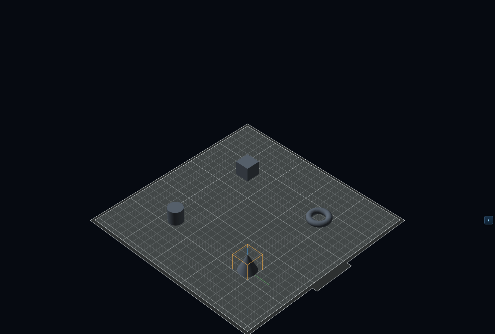
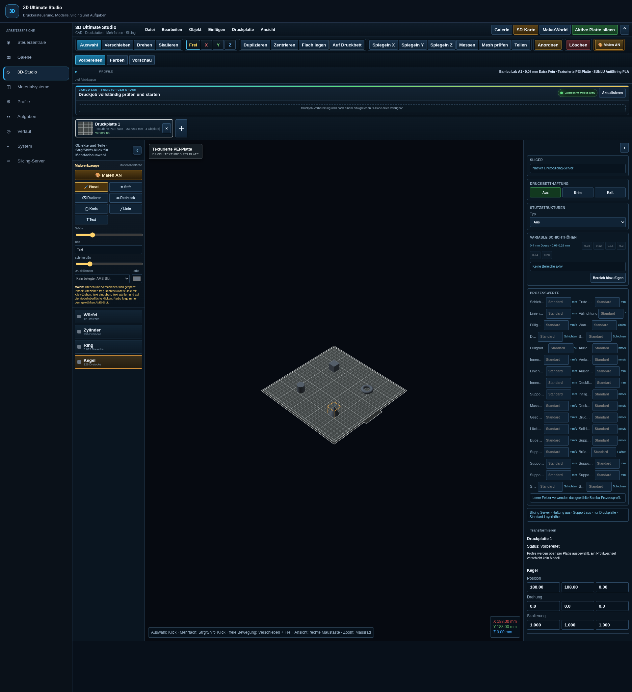

# Echte CAD-Beispiele auf der Druckplatte

[Handbuch](../README.md) · [Funktionskatalog](FEATURES.md)

*Originalaufnahme einer tatsächlich gerenderten CAD-Fläche, 15.10.2026.
Aufgenommen im vorhandenen Puppet-Add-on mit Software-WebGL. Der Bildausschnitt
wurde direkt aus dem laufenden Browser erfasst, nicht nachträglich mit Modellen
oder UI-Elementen montiert. Keine KI-generierte Produktansicht.*

## Diese Szene selbst nachbauen

1. Mit einem leeren, eigenen Studio-Arbeitsstand beginnen. Einen vorhandenen
   privaten Arbeitsstand vorher sichern, nicht für das Beispiel löschen.
2. **Einfügen → Würfel**, **Zylinder**, **Ring** und **Kegel** verwenden.
3. **Anordnen** wählen. In der Objektliste stehen vier eigenständige Modelle.
4. Mit **Alles einpassen** beginnen und über das Mausrad auf eine passende
   Ansicht zoomen. Rechte Maustaste verändert die Ansicht.
5. Den Kegel markieren: Auswahlrahmen und Achsen machen die aktuelle Auswahl
   sichtbar. Kein anderes Modell wird dadurch gelöscht oder geslicet.
6. Bei Bedarf obere und rechte Leiste über ihre Pfeile einklappen, um die
   Druckplatte größer zu betrachten.

Die gezeigte Szene verwendet ausschließlich im Studio erzeugte Grundkörper,
keine fremden Modelle, privaten Uploads oder historischen Auftragsdateien.
Für die Aufnahme wurde kein Projekt auf HA gespeichert, kein Slice angelegt
und kein Druckerkommando ausgeführt. Die Szene wurde nach dem Schließen des
isolierten Browserkontexts verworfen.

## Ganze Oberfläche

Die Profil- und Maschinenwerte gehören zur abgebildeten bestehenden
Installation. Sie sind keine Empfehlung für eine andere Maschine und kein
Nachweis, dass genau der aktuelle Repo-Stand bereits live ausgerollt ist.
Die vier neutral dargestellten Körper zeigen Geometrie, keinen angenommenen
Mehrfarbendruck. Die Materialzuordnung erfolgt getrennt.

## Bilder und Nachweis

| Datei | Abmessungen | SHA-256 |
| --- | --- | --- |
| `cad-plate.png` | 1480 × 1000 | `a00b0fa2544cc64eabafbd4ebb1accaa1a61f04d9c2e8ce4d3e55e7345575370` |
| `cad-overview.png` | 1920 × 2100 | `f5a1d21fb0d6fda78300b7ffe52bda0c1a2966d5aa49457ed233a69e973aaaae` |

Die ausgewählten Original-PNGs bleiben byteidentisch erhalten. Eine spätere
KI-Featureillustration müsste separat als Illustration gekennzeichnet und
auf diese Originalbasis zurückgeführt werden. Sie würde keine reale Funktion,
Hardwareabnahme oder Druckqualität belegen.
